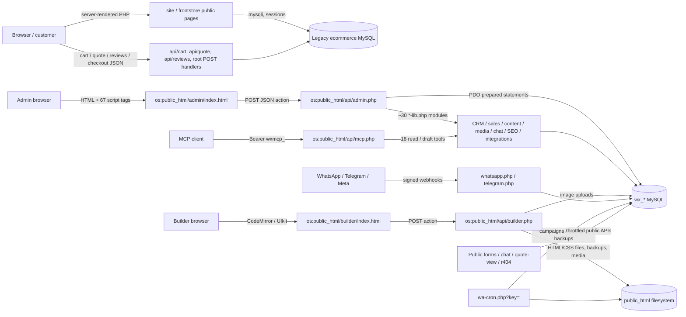
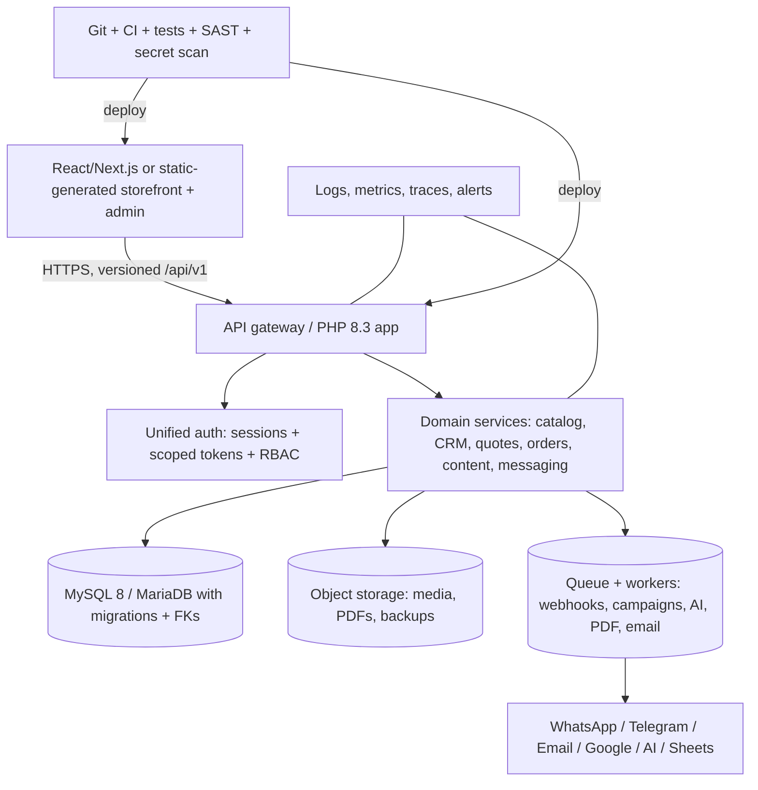

# Woodex Furniture OS — Complete Master Audit Report

**Date:** 2026-11-05 (UTC)  
**Prepared for:** full-project analysis request — *frontend, backend, database, complete master audit report, summarize code and API*  
**Source of truth:** Google Drive folder `woodex furniture os ` (`1oww6rFqvwHBqrJKKPJ5Kme4pD10BAvJ2`)  
**Repository baseline:** `woodex420/furniture-os`, branch `arena/bd434fbd-furniture-os`, commit `63225f2 Initial commit` (only `README.md` tracked)  
**Report location:** `/home/user/furniture-os/MASTER_AUDIT_REPORT.md`  
**Companion appendices:** `/home/user/furniture-os/reports/`

> **Important:** This is a static source audit of the three archives that could be retrieved. A fourth 150 MB archive could not be transferred through the Google Drive connector's 100 MiB workspace limit. The report is complete for all accessible sources, but the four-archive project is **not fully covered** until that archive is supplied in smaller parts. See [Scope limitation](#2-scope-limitations-and-coverage-gap). No password, token, API key, or database credential value is reproduced anywhere in this report.

---

## 1. Executive summary

The Git repository is not the project. It is a one-file stub. The real system lives in four archives in Google Drive and represents **two overlapping generations of the same business**:

1. **Woodex OS** — a newer, API-first PHP 8 backend plus a vanilla-JavaScript admin SPA and visual page builder. It uses a `wx_*` MySQL schema, signed admin tokens, TOTP 2FA, MCP/JSON-RPC, webhook integrations, and a release manifest.
2. **Legacy PHP storefront / `lbpanel`** — a server-rendered ecommerce site with its own `mysqli` database, session cart/quote basket, POS module, CKEditor, PHPMailer, and dompdf. Two snapshots of this storefront exist: an older `site` ZIP and a newer `frontstore` RAR5. They share 39 identical file hashes, so `frontstore` is a derivative/newer snapshot, not an independent system.

The newer OS code is materially better engineered than the legacy storefront: it uses prepared statements, HMAC-signed tokens, role checks, webhook signature verification, CSRF controls, hashed MCP tokens, an SSRF guard, and a verified file manifest. However, the overall project is **not production-safe as shipped**. The legacy archives contain hardcoded live database credentials, a credential-leaking `error_log`, `display_errors = On`, `upload_max_filesize = 9999M`, PHP session files inside the web root, an unauthenticated CKEditor upload handler, and at least 26 admin/POS write endpoints with no recognizable authentication guard. The OS installer can also be invoked unauthenticated if its private DB config is missing or broken, and demo/default credentials are documented in multiple places.

### Key numbers

| Metric | Value |
|---|---:|
| Drive archives in folder | 4 |
| Archives successfully downloaded / analyzed | 3 |
| Combined Drive archive size | 272,506,210 bytes (~260 MiB) |
| Accessible archive size | 119,047,693 bytes (~113.5 MiB) |
| Extracted source trees analyzed | 3 |
| Extracted files | 1,795 |
| Extracted bytes | 133,132,733 (~127 MiB) |
| Total lines / non-blank lines | 163,947 / 128,801 |
| Code files / code lines | 784 / 125,404 |
| OS `wx_*` tables declared in `schema.sql` | 22 |
| Foreign keys in `schema.sql` | 0 |
| Additional runtime `CREATE TABLE` definitions found in PHP | 27 |
| OS API action strings (unique) | 350 |
| PHP endpoint-like files across all trees | 112 |
| MCP tools exposed | 18 (15 read, 3 draft/notes) |
| Identical file hashes shared across trees | 40 (39 `site`↔`frontstore`, 1 `os`↔`site`) |
| Release manifest entries verified | 182 / 182 |

### Overall risk rating

**HIGH — not production-ready without P0 remediation.** The critical issues are configuration/secret leakage and missing access control in the legacy admin, not exotic code-execution bugs in the newer OS. The highest-value immediate actions are: rotate every database credential, remove hardcoded config and debug artifacts, put an auth guard in front of every `lbpanel`/POS endpoint, move secrets outside the web root, disable the unauthenticated installer, and reconcile the two divergent stacks into one versioned repository.

---

## 2. Scope limitations and coverage gap

### What was audited

| # | Drive file | ID | Size (bytes) | Actual format | Status |
|---:|---|---|---:|---|---|
| 1 | `woodex furniture os .zip` | `1l3ZCxRAOsKXU7Ad483_UZ3PPffpGu0gd` | 2,071,098 | ZIP | Extracted as `os` |
| 2 | `woodex (1).zip` | `1NitZf4qiLBMKB4BXMZJwXFFFG6N5sJw5` | 36,787,088 | ZIP | Extracted as `site` |
| 3 | `frontstore.zip` | `142_mg7fS-HkTppBIbN4vy6S_VCyN8rCe` | 83,189,507 | **RAR5, mislabeled `.zip`** | Extracted as `frontstore` |
| 4 | `woodexfurniture.pk (1).zip` | `1wR1YlJ477N_ICp8JBe6sbePX3ThgQYyA` | 150,458,517 | ZIP (metadata only) | **Not downloaded** |

Drive folder contains only these four direct children; no subfolders, extra pages, or native Google Workspace documents were listed. `woodexfurniture.pk (1).zip` was modified `2026-11-02T20:44:31Z`; Drive metadata reports SHA-256 `e212c0e06b442479af6c43a2908c63fed20547494ab97fb400f79c8bb8badb71`, MD5 `630e2119b6c2bf1d4d4fdd53f7840dc0`, and SHA-1 `2cd1d12989e53843e52d8ac9273ddad690a7c10a`. Its contents remain unknown.

### Why archive 4 is missing

- `google_drive__download_file` fails above the connector's 100 MiB workspace cap.
- `google_drive__read_file_text` fails above its 25 MiB extraction cap.
- `google_drive__get_file` returns metadata/checksums only.
- `google_drive__export_file` is not applicable to a stored binary ZIP.
- Repeated download attempts, `acknowledge_abuse=true`, and direct `uc?export=download` fetches were unsuccessful.

Direct link: <https://drive.google.com/file/d/1wR1YlJ477N_ICp8JBe6sbePX3ThgQYyA/view?usp=drivesdk>

**To complete the audit:** provide a split/recompressed copy under 95 MB per part, or a source-only archive excluding `vendor/`, `node_modules/`, media, and backup folders. A short addendum will then reconcile any new code, routes, database schema, media, or configuration. Until then, this report must not be read as an audit of all four archives.

### Method and notation

- Archives were extracted with Python `zipfile` and a local `node-unrar-js@2.0.2` WASM extractor for the RAR5 file.
- A custom Python analyzer aggregated file/extension counts, line counts, duplicate content hashes, schema DDL, PHP case labels, endpoint-like files, `.htaccess` rules, external hosts, and security regex patterns.
- High-risk areas were then manually reviewed: auth/session flow, SQL construction, file uploads, SSRF guards, `.htaccess`, config files, runtime artifacts, and release manifest.
- No live PHP/MySQL execution, no authenticated penetration test, no dynamic DAST, and no production database access were performed.
- Paths use `tree:relative/path`: `os:`, `site:`, `frontstore:`. For example, `os:public_html/api/admin.php` = `/tmp/audit/os/public_html/api/admin.php`.
- Static regex counts are indicators only; they are not confirmed vulnerabilities. Confirmed findings are called out with file/line evidence in `reports/SECURITY_FINDINGS.md`.

---

## 3. Source inventory and integrity

| Tree | Archive | Files | Bytes | Lines | Non-blank | Code files | Code lines | Notes |
|---|---|---:|---:|---:|---:|---:|---:|---|
| `os` | `woodex furniture os .zip` | 183 | 5,720,595 | 32,730 | 29,932 | 147 | 26,701 | New backend/admin/database release; 182 files verified against `docs/RELEASE-MANIFEST.json`. |
| `site` | `woodex (1).zip` | 1,071 | 36,553,080 | 100,566 | 71,816 | 560 | 71,665 | Older legacy storefront; ZIP entries dated `2026-02-19 12:23:20`. |
| `frontstore` | `frontstore.zip` (RAR5) | 541 | 90,859,058 | 30,651 | 27,053 | 77 | 27,038 | Newer-looking frontend snapshot; RAR entries dated `2026-11-03 10:15–10:18`. |
| **Total** | 3 archives | **1,795** | **133,132,733** | **163,947** | **128,801** | **784** | **125,404** | Includes vendored libraries and media. |

Local SHA-256 of downloaded archives:

| Archive | SHA-256 |
|---|---|
| `woodex furniture os .zip` | `e5980a1ae1e0e6c24ecce2a1e41cd6293c8464dfd94be4dcf9bddd1a02dd976f` |
| `woodex (1).zip` | `8b34277d831401d482ecae01f316340aff98c81e2397477a78727e6a18c9d7cf` |
| `frontstore.zip` | `eaa583b7f6e7ba52425266ee68d9530ec5724cfdf96e035d02b84a2d5c0c5d55` |

### Relationship between trees

- `frontstore.zip` is RAR5 despite its `.zip` name and Drive MIME `application/x-zip-compressed`; filename/MIME cannot be trusted.
- `site` contains `lbpanel/` (418 files), `sessions/` (258 files), `vendor/dompdf`, `phpmailer/`, CKEditor, and 40 root PHP pages.
- `frontstore` contains 51 root PHP pages, 71 PHP files total, 460 image files (~90 MB), 13 `api/` scripts, `redirect.php`, and a sanitized `config/connection-real.php`.
- 39 identical content hashes are shared between `site` and `frontstore`; 1 between `os` and `site`; 0 between `os` and `frontstore`. This strongly indicates `frontstore` is a later derivative of `site` with added quote/review/product APIs and rewritten `.htaccess`.
- The small `os` archive is **backend/admin/database only**; it is not a full public storefront.
- The 150 MB archive likely contains another full production snapshot (possibly `woodexfurniture.pk` v1), but its role cannot be confirmed.

### Git baseline

`git ls-tree -r --name-only HEAD` returns only `README.md`. History is shallow/grafted with one commit `63225f2 Initial commit`; `main`, `origin/main`, and `origin/HEAD` are aligned. Remote is `https://github.com/woodex420/furniture-os.git`. **Do not use Git as the source of truth for this project.** The Drive archives are the project; the repository should become the source of truth only after a controlled import.

---

## 4. Architecture

There are effectively **three front doors**: the public PHP storefront, the newer Admin SPA, and the Builder. They do not share one application framework, one auth system, one database schema, or one deployment pipeline. The OS backend writes both to MySQL and directly to `public_html` HTML/CSS files; the legacy storefront writes to a separate MySQL database through `mysqli`.

---

## 5. Frontend audit

### 5.1 New OS Admin SPA

- Entry: `os:public_html/admin/index.html`, `admin.css`, `admin.js`.
- **67 `<script src>` tags**, 79 JavaScript files, 3 CSS files, 8 HTML files in the OS tree.
- No framework, no bundler, no `package.json`, no module graph; modules are loaded as global scripts and named by delivery phase (`admin-p18.js`, `admin-p19f.js`, `admin-p38wa.js`, `admin-seo38.js`, etc.).
- Vendored browser libraries: Chart.js 4.4.1 (`admin/vendor/chart.umd.js`, 205 KB), `html2pdf.bundle.min.js` (906 KB), `qrcode.js`, `icons.js`, `quote-starter.js`.
- Functional domains visible from module names: dashboard/reports, CRM, sales/quotes/invoices, sales17, content/CMS, media, system, settings, theme, XLSX/Sheets, chat, notifications, SEO/AI, offers, Google integrations, inbox, users, redirects, templates, bookings, approvals, Telegram, WhatsApp hub, AI center, social, and SEO agent.
- Largest client files: `admin-content.js` 123 KB, `admin-sales17.js` 97 KB, `admin-sales.js` 81 KB, `admin-media.js` 55 KB, `admin-chrome.js` 53 KB.

**Assessment:** feature-rich but high maintenance risk. Global-script architecture creates ordering/global-namespace coupling, no tree-shaking, no type checking, and no automated test seams. A 67-script bootstrap is fragile; a single missing/deferred script can break unrelated modules.

### 5.2 Builder

- Entry: `os:public_html/builder/index.html`, `builder.js` 167 KB, 13 script tags.
- Uses CodeMirror, `icons.json` (565 KB), `google-fonts.js`, UIkit, `blocks.js`, `templates-v26.js`, `wx-css.js`, and phase add-ons (`builder-p17.js`, `builder-p18f.js`, `builder-p18k.js`, `builder-p38.js`).
- Saves generated HTML pages directly to disk, keeps up to 30 timestamped backups per page, manages media in `assets/media`, and supports theme CSS through a whitelist.
- `code_guard()` restricts raw `<script>` insertion to owner role; `import_url`/`fetch_page` enforce public HTTPS, DNS resolution, private-IP blocking, and `CURLOPT_FOLLOWLOCATION = false`.

**Assessment:** powerful but couples content editing to filesystem writes and Apache rewrites. Without a build/CI layer, a bad save can publish broken markup; backups are the only rollback mechanism.

### 5.3 Public storefront

The legacy storefront is server-rendered PHP with mixed HTML/CSS/JS in single files.

| Area | `site` | `frontstore` |
|---|---:|---:|
| Root `.php` pages | 40 | 51 |
| Total `.php` files | 256 | 71 |
| `.js` / `.css` / `.html` | 231 / 25 / 27 | 5 / 1 / 0 |
| Image files | ~177 | 460 |
| `api/` scripts | 11 | 13 |

Representative page groups:

- **Catalog:** `index.php`, `shop.php`, `singleproduct.php`, `servicedetail.php`, `product_categories.php`, `filters_meta.php`, `fetch_products.php`.
- **Cart / checkout:** `cart.php`, `checkout.php`, `api/cart/add|count|get|remove|update|save_totals.php`, `apply_coupon.php`, `process_checkout.php`, `order_success.php`.
- **Quotation flow:** `equotation.php`, `quotation-basket.php`, `api/quote/*`, `submit_quote_request.php`, `generate_quotation_pdf.php`, `generate_quote_request_pdf.php`.
- **Content / marketing:** `about.php`, `services.php`, `projects.php`, `sale.php`, `warranty.php`, `contact.php`, `reviews.php`, `api/reviews/submit-customer-review.php`, `api/search/suggest.php`, `redirect.php`.
- **State:** `$_SESSION['cart']` and `$_SESSION['quote_basket']`.

Frontend dependencies are CDN-heavy: `cdn.jsdelivr.net` (70 references), `cdnjs.cloudflare.com` (66), `code.jquery.com` (22), Google Fonts, Unsplash, Font Awesome, Owl Carousel, Bootstrap 5.3.0-alpha3, Bootstrap Icons, jQuery 3.5.1 in `lbpanel/login.html`. **Zero `integrity=` attributes** were found, so all CDN scripts are unpinned against tampering.

### 5.4 Routing and `.htaccess`

| Tree | Lines | RewriteRule lines | Key behavior |
|---|---:|---:|---|
| `os:public_html/.htaccess` | 75 | 44 | Forces non-`www` HTTPS, denies `_private`, `_database`, `_templates`, installer/demo/check/log files; sets nosniff, Referrer-Policy, X-Frame-Options, Permissions-Policy, HSTS; many SEO/spam cleanup redirects; `coming-soon.html` / `500.html` error docs. |
| `site:.htaccess` | 138 | 24 | Forces `www` HTTPS, friendly URLs, CKEditor/PHP upload size hints, gzip, cache headers, security headers. **Line 20 typo:** redirects to `woodexurniture.pk` (missing `f`). |
| `frontstore:.htaccess` | 225 | 73 | Forces non-`www` HTTPS, extensionless friendly URLs, product/category/service/blog/project rewrites, `redirect.php` fallback for DB-driven redirects, denies hidden/sensitive extensions, includes `redirect.php` allow for `lbpanel|api`. |

Conflicting canonical-host rules are a real deployment bug: `site` forces `www`, while `os` and `frontstore` force non-`www`. `frontstore` also routes unresolved paths to `redirect.php` backed by an `url_redirects` table. Full rule-by-rule inventory: `reports/ROUTES.md`.

### 5.5 Frontend quality findings

- Large mixed PHP/HTML/CSS/JS files: `frontstore:index.php` ~101 KB, `singleproduct.php` ~58 KB, `servicedetail.php` ~49 KB; `site:index.php` ~54 KB.
- Inline styles/scripts are common; no template engine or component system.
- `frontstore` PDF endpoints expect `__DIR__.'/vendor/autoload.php'` (`generate_quotation_pdf.php:27`, `generate_quote_request_pdf.php:6`), but the `frontstore` archive contains no `vendor/` directory and no `autoload.php`. The `site` archive contains `vendor/dompdf` but also no root `vendor/autoload.php`. PDF generation will degrade to HTML fallback unless dependencies are installed separately.
- `frontstore:config/connection-real.php` says a mock `connection.php` can be switched with `FRONTSTORE_USE_MOCK=0`; no `FRONTSTORE_USE_MOCK` reference exists anywhere in code. The actual `frontstore/connection.php` and `frontstore/lbpanel/config/connection.php` are real configs with hardcoded live fallbacks.
- `site:lbpanel/login.html` posts to `login_process.php`, which is absent; the working login is `lbpanel/index.php`. `pos/manage_pos.php` references `../login.php`, also absent.

---

## 6. Backend and API audit

### 6.1 New OS endpoints

| Endpoint | Auth | Purpose |
|---|---|---|
| `POST /api/admin.php` | `X-WX-ADM` HMAC token; roles owner/admin/editor/sales/support | Main action dispatcher for CRM, sales, CMS, media, security, integrations, system. |
| `POST /api/builder.php` | `X-WX-CSRF` builder token or admin token | Pages, backups, media, theme, blocks, import/fetch, uploads. |
| `GET/POST /api/forms.php` | Public; honeypot, IP throttle, optional Turnstile | Leads, `wa_click`, booking config/slots/create. |
| `POST /api/frontend-auth.php` | `wx_fe_session` cookie or `Bearer wxfe_`; CSRF for password | Customer register/login/me/logout/password. |
| `POST /api/chat.php` | Visitor `chat_id` + SHA-256 token | Chat cfg/send/poll/typing/file/Telegram link. |
| `POST /api/mcp.php` | `Authorization: Bearer wxmcp_…` | JSON-RPC 2.0 MCP server; 18 tools. |
| `GET /api/quote-view.php?id=&t=` | Signed HMAC link token | Client quotation viewer, `noindex`. |
| `GET/POST /api/whatsapp.php` | Meta verify token + `X-Hub-Signature-256` | WhatsApp Cloud API webhook. |
| `POST /api/telegram.php` | `X-Telegram-Bot-Api-Secret-Token` | Telegram bot webhook. |
| `GET /api/wa-cron.php?key=` | Cron key in query string | WhatsApp campaigns, social/SEO agents, offsite backups. |
| `POST /api/r404.php` | Public beacon | 404 monitoring. |

Full endpoint/action inventory: `reports/API_INVENTORY.md` and `reports/API_INVENTORY.json`.

### 6.2 Admin action dispatcher

`os:public_html/api/admin.php` is a 643-line front controller with 33 direct `case` labels and a `default:` that delegates to roughly 30 `*-lib.php` action handlers. Across all OS API files, the analyzer found **350 unique action strings** and **1,094 PHP case labels in total** across all three trees (many in vendored code). The 297 admin/library action rows group as:

| Domain | Approx. actions | Examples |
|---|---:|---|
| Core/admin/pages/users | 66 | `status`, `setup`, `login`, `logout`, `me`, `schema_check`, `schema_repair`, `sys_check`, `db_reconnect`, `users`, `user_save`, `dashboard`, `activity`, `pages_list`, `global_menu` |
| Content/CMS | 30 | `cms_list`, `cms_get`, `cms_save`, `cms_published`, `ai_run`, `cms_ai_models` |
| Builder | 26 | `pages`, `load`, `save`, `backups`, `restore`, `media`, `import_url`, `fetch_page`, `upload`, `theme` |
| MCP JSON-RPC / tools | 23 | `initialize`, `ping`, `tools/list`, `tools/call`, plus 18 tool cases |
| AI/SEO | 21 | `seo_list`, `seo_page`, `seo_scores`, `sag_scan`, `sag_propose`, `aic_get`, `aia_report` |
| Live chat | 15 | `chat_list`, `chat_assign`, `chat_reply`, `chat_mode`, `chat_cfg_save` |
| WhatsApp campaigns | 14 | `wag_get`, `wag_audience`, `wag_camp_save`, `wag_tick`, `wag_test` |
| CRM leads/clients/settings | 27 | `leads_list`, `lead_save`, `lead_note`, `clients_list`, `crm_*` |
| Sales quotes/invoices/projects | 28 | `quotes_list`, `quote_save`, `invs_list`, `proj_*`, `s17_*` |
| Media / file manager / DB browser | 17 | `media_list`, `fm_upload`, `fm_delete`, `dbx_tables`, `dbx_browse` |
| Telegram / social / notifications / redirects / bookings / integrations | ~45 | `tg_*`, `soc_*`, `notif_*`, `rd_*`, `bk_*`, `sheets_*`, `google_*`, `gdata_*` |

### 6.3 Authentication and authorization models

| System | Model |
|---|---|
| Admin | `uid.exp.sid.sig` HMAC token in `X-WX-ADM`, 12-hour expiry, secret from `_private/config.json`, live-session revocation in `_private/security.json`, `password_hash`/`password_verify`, TOTP + recovery codes, IP throttle, `need()` and `wx_allowed()` role/action checks. |
| Builder | `exp.uid.sid.sig` HMAC token in `X-WX-CSRF`, same 12-hour window, optional separate builder password. |
| Customer frontend | `wx_frontend_users` / `wx_frontend_sessions`, SHA-256 token hashes, HttpOnly `wx_fe_session`, readable `wx_fe_csrf`, optional `Bearer wxfe_`, CSRF on password change, login/register throttles. |
| MCP | `wxmcp_…` bearer tokens hashed in `_private/mcp.json`, per-token user permissions, JSON-RPC 2.0, `tools/call` restricted to read tools and safe draft/notes. |
| Webhooks | WhatsApp `X-Hub-Signature-256` fail-closed; Telegram secret-token header; Meta verify token for GET challenge. |
| Legacy `lbpanel` | Session-based `index.php` login with `password_verify`, but **no centralized auth guard**; only 17 of 45 session-using files contain an auth-like check. |

### 6.4 Integrations

The OS backend references WhatsApp Cloud API, Telegram Bot API, Cloudflare Turnstile, SMTP/PHPMailer, Google Sheets, Google OAuth/Analytics/Search Console, PageSpeed Insights, OpenAI-compatible AI endpoints, social posting, Meta Pixel/GTM, offsite backups, and SEO agents. Runtime secrets are expected in `_private/*.json`; `db.example.json` contains placeholders only. Production `db.json`, `config.json`, `security.json`, and `mcp.json` are correctly excluded from the small OS archive — but they are still designed to live under `public_html/_private/`, which is a deployment risk.

### 6.5 Legacy API surface

112 PHP endpoint-like files were found across `site` and `frontstore`. They are mostly small, session-backed `mysqli` scripts:

- `api/cart/add|count|get|remove|update|save_totals.php`
- `api/quote/add|count|get|remove|update.php`
- `api/search/suggest.php`
- `api/reviews/submit-customer-review.php`
- `api/product/quick-view.php`
- Root handlers: `apply_coupon.php`, `submit_contact.php`, `subscribe.php`, `process_checkout.php`, `fetch_products.php`, `filters_meta.php`, `submit_quote_request.php`, `generate_quotation_pdf.php`, `generate_quote_request_pdf.php`, `redirect.php`, `session_test.php`.

Many use prepared statements; targeted review found **no high-confidence direct `$_GET`/`$_POST`/`$_REQUEST` interpolation into SQL strings**. However, dynamic SQL builders exist in `fetch_products.php`, `filters_meta.php`, `footer.php`, `header.php`, and redirect/auto-migration helpers. These need runtime testing. No CSRF tokens, no shared rate limiting, and no centralized authorization were found in the legacy layer.

### 6.6 Cron, webhooks, and filesystem writes

- `wa-cron.php?key=` is guarded by a cron key stored in `wx_settings`; the key travels in the URL.
- `whatsapp.php` fails closed when the signature header or app secret is missing.
- `telegram.php` requires the secret-token header when configured.
- `forms.php` deliberately accepts a lead if Cloudflare Turnstile is unreachable (`forms.php:80`) to avoid losing leads — a fail-open decision.
- `builder.php` writes HTML/CSS, keeps 30 backups, uploads verified images with random filenames, and can enter maintenance mode by rewriting `.htaccess`.
- `p18h-lib.php` implements a file manager under `assets/` with path normalization, but permits `.svg` uploads and uses a regex `<script>` strip.

---

## 7. Database audit

### 7.1 Two database worlds

| World | Access | Schema source | Tables |
|---|---|---|---|
| Woodex OS | PDO, config in `_private/db.json` | `os:database/schema.sql`, `os:database/demo-seed.sql`, runtime PHP DDL | 22 `wx_*` tables declared |
| Legacy storefront | `mysqli`, hardcoded PHP config | **No schema file found** | ~35 tables referenced in code |

The legacy config points to a different database than the `wx_*` schema. `schema.sql` comments mention an installer `wx-install.php` that is not included in the OS archive. `demo-seed.sql` inserts staging-only demo admin/customer accounts with bcrypt hashes; credentials are documented in `README.md`/`FRONTEND-INTEGRATION.md` but intentionally not reproduced here.

### 7.2 `wx_*` schema summary

All 22 tables use `ENGINE=InnoDB DEFAULT CHARSET=utf8mb4`, `CREATE TABLE IF NOT EXISTS`, and **zero foreign keys**. Every table has a primary key (inline or table-level), but logical relationships are enforced only in PHP.

| Category | Tables | Notes |
|---|---|---|
| Identity / security | `wx_users`, `wx_frontend_users`, `wx_frontend_sessions`, `wx_throttle`, `wx_settings`, `wx_activity` | Admin + customer identity are separate. `wx_throttle` is a generic key-prefixed rate-limit table. `wx_settings` stores config/secrets as plaintext `TEXT`. |
| CRM | `wx_leads` (32 cols), `wx_lead_notes`, `wx_clients` | `wx_leads.fields` is JSON in `TEXT`; 4 indexes on stage/created/client/next. |
| Sales | `wx_quotes`, `wx_invoices`, `wx_projects`, `wx_templates` | Whole documents stored as JSON in `LONGTEXT`; `wx_invoices.quote_id` is unique but not a FK; `wx_quotes.no` indexed but not unique. |
| Chat / AI | `wx_chats` (20 cols), `wx_chat_msgs`, `wx_ai_events`, `wx_ai_unans` | `wx_chats.token` has no index; `wx_chat_msgs` has `(chat_id, id)`. |
| Messaging / dedupe | `wx_wa_seen`, `wx_tg_seen`, `wx_tg_map`, `wx_notify_log` | WhatsApp/Telegram message dedupe and notification log. |
| Bookings | `wx_bookings` | 17 columns, single index on `d`. |
| Leads follow-up | `wx_lead_notes`, `wx_notify_log` | Notes and outbound notification audit. |

Top table references in OS PHP: `wx_leads` 78, `wx_chats` 77, `wx_users` 58, `wx_invoices` 35, `wx_clients` 34, `wx_projects` 30, `wx_quotes` 29, `wx_chat_msgs` 28, `wx_throttle` 26, `wx_bookings` 22.

### 7.3 Schema drift

- `admin.php::schema_requirements()` expects `wx_chats.handoff`, `ext`, `assigned_to`, and `tags`; none are in `schema.sql`. `schema_repair()` adds missing columns at runtime.
- 27 additional `CREATE TABLE IF NOT EXISTS` definitions were found inside PHP, including legacy tables (`customer_reviews`, `footer_settings`, `footer_links`, `topbar_settings`, `sale_page_settings`, `quotation_requests`, `quotation_request_items`, `product_categories`, `projects`).
- Runtime migrators exist in `admin.php`, `crm-lib.php`, `sales-lib.php`, `chat-lib.php`, `booking-lib.php`, `frontend-auth.php`, `p18h-lib.php`, and in `frontstore` footer/header/review/category helpers.
- `CREATE TABLE IF NOT EXISTS` does not reconcile changed column types or indexes. There is no migration version table, no down migration, and no rollback script.

### 7.4 Design gaps

- No `FOREIGN KEY` constraints; no database-level cascade/consistency.
- JSON-in-`LONGTEXT` prevents indexed queries on quote/invoice/project fields and complicates reporting.
- Missing useful indexes: `wx_chats.token`, `wx_leads.email`, `wx_clients.email`, composite `(lead_id, created_at)`, broader `wx_bookings` indexes.
- No soft deletes, no tenant/company scoping, no row-level audit metadata on several tables.
- `wx_settings` plaintext key/value store may hold integration secrets; no encryption at rest.
- No row counts, no ERD, no production schema dump, and no live DB access in this audit.

Full column-by-column schema, indexes, drift, and legacy table references: `reports/DATABASE_SCHEMA.md` and `reports/DATABASE_AUDIT.json`.

---

## 8. Security audit

The full findings table is in `reports/SECURITY_FINDINGS.md`. Summary:

| Severity | Count | Headline |
|---|---:|---|
| Critical | 3 | Hardcoded live DB credentials; unauthenticated legacy admin writes; unrestricted CKEditor upload |
| High | 5 | Debug artifacts in web root; unauthenticated installer/reconnect; default/demo credentials; web-root private secrets; legacy CSRF |
| Medium | 10 | Conflicting rewrites, missing CSP/HSTS, wildcard MCP CORS, cron secret in URL, fail-open Turnstile, SSRF surface, SVG upload, no legacy rate limiting, CDN without SRI, EOL/unlocked dependencies |
| Low | 4 | Status fingerprinting, no CI/secret scanning, inconsistent config copies, schema drift |

### Most urgent evidence

- `site:lbpanel/config/connection.php:3-6`, `frontstore:connection.php:23-25`, `frontstore:lbpanel/config/connection.php:23-25`: hardcoded live DB fallbacks. `site:error_log:1-2`: a second DB username/password appears inside uncaught `mysqli` stack traces. Values are redacted in this report.
- `site:php.ini:6,14` and `.user.ini:7,14,15`: `display_errors = On`, `upload_max_filesize = 9999M`, session path inside public web root. `site:sessions/` contains 258 session files; `session_test.php` prints session data.
- `site:lbpanel/includes/ckeditor/upload.php:1-26`: no auth, no extension/MIME allowlist, original filename, writes under `DocumentRoot`, and echoes `$_GET[CKEditorFuncNum]` into JavaScript.
- 45 `lbpanel` files call `session_start()`; only 17 have a recognizable authorization check; 26 write-capable endpoints lack one, including `php/process_add_product.php`, `php/process_add_coupon.php`, `pos/api/save_transaction.php`, and `edit_product.php`.
- `os:public_html/api/admin.php:387-410`: `setup`/`db_reconnect` are reachable without a normal admin session when DB config is missing/broken; builder password is optional. Line 401 references `admin / admin`.
- `os:public_html/_private/` is inside `DocumentRoot`; protection depends on `mod_rewrite`/`AllowOverride`. If either is off, DB config, HMAC secret, TOTP seeds, MCP token hashes, and approval settings may be downloadable.
- `site:.htaccess:16,20` forces `www` and contains a misspelled canonical host; `os` and `frontstore` force non-`www`.
- `os:public_html/api/mcp.php:17` sends `Access-Control-Allow-Origin: *`.

### Positive controls to preserve

HMAC-signed admin/builder tokens with revocation, TOTP/recovery codes, `password_hash`/`password_verify`, role/action checks, hashed frontend session tokens, CSRF on frontend password change, fail-closed WhatsApp/Telegram signature checks, hashed MCP tokens, 18 MCP tools limited to read/drafts, image-content verification and random upload names, public-HTTPS-only SSRF guards, `JSON_HEX_*` escaping in `quote-view.php`, upload-directory PHP disabling, and a release manifest that verified 182/182 file hashes.

### Static scan interpretation

`reports/STATIC_SCAN.json` records 456 SQL string-interpolation candidates (82 files), 151 SQL strings near superglobals (58 files), 288 prepared-statement markers (82 files), 717 `htmlspecialchars` calls (77 files), 17 `hash_equals`, 14 `password_hash`, 10 `password_verify`, and 5 high-confidence literal secret-like assignments. These are **grep heuristics**. Manual review of cart, quote, review, checkout, search, and admin handlers found extensive prepared-statement use and no confirmed direct superglobal-to-SQL injection. Dynamic SQL builders and all upload/SSRF guards still require staging DAST.

---

## 9. Code quality, dependencies, and maintainability

| Observation | Evidence | Impact |
|---|---|---|
| Two divergent stacks, no shared kernel | `os` vs `site`/`frontstore` | Duplicate business logic, divergent auth/DB/config, high integration cost. |
| Monolithic dispatcher | `admin.php` 643 lines; 350 actions; ~30 libraries | Hard to test, easy to miss permission checks, large blast radius. |
| Monolithic frontend files | `builder.js` 167 KB; `admin-content.js` 123 KB; `index.php` 101 KB; 67 script tags | Slow load, global namespace coupling, no type safety. |
| Phase-based naming | `p18`, `p19`, `p38`, `sales17`, `seo38` | History is encoded in filenames, not Git tags/migrations; hard onboarding. |
| No tests / CI / build | No PHPUnit, Playwright, GitHub Actions, Dockerfile, lint config, or app lock files found | Regressions and secret leaks are undetectable before deploy. |
| Vendored dependencies | PHPMailer 6.9.3, dompdf git snapshot `<3beae5028>`, CKEditor 4.25.0-lts, Chart.js 4.4.1, html2pdf, qrcode, CodeMirror, UIkit, Bootstrap 5.3.0-alpha3, jQuery 3.5.1 | No update path; CKEditor 4 open-source edition is explicitly EOL; Bootstrap alpha and old jQuery are risky. |
| External host noise | Vendored CKEditor docs dominate: `ckeditor.com` 1,475, `github.com` 836, `dev.ckeditor.com` 800, `www.w3.org` 227, `cdn.jsdelivr.net` 223, `cdnjs.cloudflare.com` 169 | Large vendored trees inflate archive size and audit surface without being application code. |
| Inconsistent config | `frontstore/connection.php`, `frontstore/lbpanel/config/connection.php`, `frontstore/config/connection-real.php` | Three copies with different credential handling and a dead `FRONTSTORE_USE_MOCK` comment. |
| Missing runtime dependencies | `frontstore` PDF endpoints expect `vendor/autoload.php` not shipped | PDF features fail or fall back to HTML. |

---

## 10. Deployment and operations

- **Platform:** Apache / cPanel / Hostinger-style shared hosting, PHP 7.4+ compatibility shims in OS, PHP 8.1 session path in legacy `.user.ini`, MySQL/MariaDB.
- **Config:** OS uses `_private/db.json` + `_private/config.json`; legacy uses hardcoded PHP constants/arrays. No `.env`, no secret manager, no environment separation.
- **Content deployment:** Builder writes directly to `public_html`; maintenance mode rewrites `.htaccess`; admin backups and builder 30-version backups are the only rollback mechanism.
- **Canonical host:** three conflicting `.htaccess` policies plus a typo. Must be unified before SEO/redirect work.
- **Observability:** `wx_activity` and `wx_notify_log` in OS; `site:error_log` and `os:public_html/_private/logs` in filesystem. No structured logging, SIEM, uptime checks, or alerting.
- **Backups:** admin `backup_get`/`backup_*`, builder page backups, `mt_offsite_backup` in cron. No documented retention, encryption, or restore test.
- **Source control:** Git repo is empty; Drive ZIP/RAR snapshots are the de-facto version control. This is the single biggest process risk.

---

## 11. Prioritized remediation roadmap

### P0 — immediate (same day)

1. **Rotate all database credentials** found in the legacy configs and `error_log`; rotate any API keys that may have been stored alongside them. Purge/replace the Drive archives with sanitized copies.
2. **Remove hardcoded config and debug artifacts** from deployable trees: `site:lbpanel/config/connection.php`, `frontstore:connection.php`, `frontstore:lbpanel/config/connection.php`, `php.ini`, `.user.ini`, `session_test.php`, `error_log`, `.DS_Store`, `sessions/`. Move config outside `DocumentRoot` into env vars/secret store.
3. **Shut down or gate `lbpanel` and `pos/api`** behind a mandatory auth include and web-server deny rules. Disable `includes/ckeditor/upload.php`; scan its upload directory for PHP/JS payloads.
4. **Harden PHP runtime:** `display_errors = Off`, `log_errors = On`, `upload_max_filesize`/`post_max_size` to 10–20 MB, sessions outside web root, `session.cookie_secure/httponly/samesite`.
5. **Disable OS `setup`/`db_reconnect`** after install; require bootstrap secret from environment; remove `admin / admin` hint and demo seed from production.
6. **Move `_private` outside `DocumentRoot`** and add server-level deny that does not depend on `.htaccess`.
7. **Unify canonical host**, fix `woodexurniture.pk` typo, enable HSTS, add CSP.
8. **Supply the missing 150 MB archive** in parts under 95 MB; issue the audit addendum.

### P1 — 1–2 weeks

- Import one canonical tree into Git on `arena/bd434fbd-furniture-os`; delete duplicate snapshots; add `.gitignore` for archives, runtime logs, sessions, `_private`.
- Add `.env.example`, a single config loader, and secret scanning in pre-commit/CI.
- Introduce versioned migrations; reconcile `wx_chats` drift; add FKs/indexes; obtain `mysqldump --no-data` for the legacy DB.
- Add CSRF tokens, `SameSite` cookies, and rate limiting to every legacy state-changing endpoint.
- Add automated tests: PHPUnit for API/auth/SQL, integration tests for cart/quote/checkout, Playwright smoke tests for admin/builder/public site.
- Replace CKEditor 4 / old Bootstrap / old jQuery; add Composer/npm lock files and SCA scanning.
- Add SRI or self-host pinned CDN assets; add CSP nonces.
- Replace query-string cron key with a header and short-lived token; restrict MCP CORS to known origins.
- Add structured logging, uptime monitoring, backup encryption, retention, and a documented restore drill.

### P2 — 1–3 months

- Consolidate the two stacks into one domain model, one auth system, one database, and one versioned API (OpenAPI contract).
- Replace direct HTML-file publishing with a database-backed CMS or a build pipeline that produces immutable artifacts.
- Normalize JSON-in-`LONGTEXT` document tables where reporting requires it; add soft deletes, audit fields, and encryption for sensitive PII.
- Add role/permission integration tests, WAF, SAST/DAST, and dependency-update automation.
- Create staging/production parity with blue/green or atomic symlink deploys.
- Decommission `lbpanel` or wrap it behind the new OS admin until migration is complete.

---

## 12. Recommended target architecture

The goal is not to rewrite everything at once. First make the current deployment safe (P0), then make it reproducible (P1), then converge the two stacks (P2).

---

## 13. Appendices

| File | Contents |
|---|---|
| `reports/API_INVENTORY.md` | Endpoint table, admin action groups, MCP tools, legacy endpoint groups, route pointers. |
| `reports/API_INVENTORY.json` | Machine-readable list of 350 unique OS API actions with file/line, plus endpoints and legacy endpoint paths. |
| `reports/DATABASE_SCHEMA.md` | All 22 `wx_*` tables column-by-column, keys/indexes, drift, demo seed, legacy DB notes. |
| `reports/DATABASE_AUDIT.json` | Machine-readable schema, keys, drift, runtime migrators, legacy table references. |
| `reports/SECURITY_FINDINGS.md` | 22 findings with severity, evidence paths/lines, impact, remediation, positive controls, static-scan interpretation. |
| `reports/STATIC_SCAN.json` | Regex counts, secret-scan summary (values redacted), archive SHA-256, manifest verification. |
| `reports/ROUTES.md` | All `RewriteRule` lines from the three `.htaccess` files with line numbers. |
| `reports/SOURCE_INVENTORY.csv` | Per-tree, per-extension file and byte counts. |
| `reports/AUDIT_INDEX.md` | Index and reading order for the appendices. |
| `reports/MASTER_AUDIT_REPORT.html` | Print-friendly HTML rendition used for the Google Doc copy. |

---

## 14. Quick code / API summary

- **Frontend:** 3 UIs — legacy server-rendered PHP storefront (`site`/`frontstore`), vanilla-JS Admin SPA (67 scripts), and visual Builder (13 scripts). No framework, no bundler, no SRI, no CSP.
- **Backend:** 11 OS public/API endpoints; `admin.php` is a 350-action dispatcher; `builder.php` has 26 actions; `mcp.php` exposes 18 JSON-RPC tools; ~112 legacy PHP endpoint-like files.
- **Auth:** strong HMAC/TOTP/RBAC in OS; weak/incomplete session auth in legacy `lbpanel`; separate customer identity in `wx_frontend_*`.
- **Database:** 22 `wx_*` tables, 0 foreign keys, 27 runtime DDL definitions, 4 missing `wx_chats` columns in `schema.sql`, plus an undocumented legacy ecommerce DB with no schema file.
- **Greatest strengths:** signed tokens, prepared statements, webhook signature verification, MCP draft-only writes, release manifest integrity, SSRF/upload guards.
- **Greatest risks:** hardcoded DB credentials, credential-leaking logs, unauthenticated legacy admin/upload endpoints, debug artifacts in web root, private secrets under `DocumentRoot`, two divergent stacks, no CI/tests/migrations.
- **Coverage:** complete for 3 of 4 Drive archives; 150 MB `woodexfurniture.pk (1).zip` still required for a fully complete four-archive audit.
